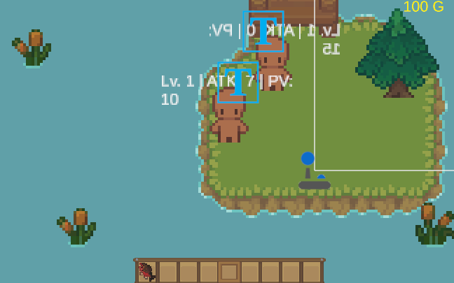

<div align="center">

# Caprinoir

**Jeu 2D multijoueur de ferme et d'aventure : cultiver, pêcher, explorer des grottes et affronter des ennemis**


[Installation](#mise-en-place) · [Commandes](#commandes) · [Signaler un bug](../../issues)



</div>

---

## Le jeu

Caprinoir est un jeu en 2D vue de dessus. On y cultive des légumes à la ferme, on pêche au lac, on commerce au village et on descend dans des grottes (5 étages) peuplées d'ennemis, en solo ou à plusieurs : un joueur héberge la partie, les autres la rejoignent.

---

## Stack technique

| | |
|---|---|
| **Moteur** | Unity 6 (`6000.3.4f1`), rendu 2D, Tilemaps |
| **Langage** | C# (≈ 2 600 lignes de scripts de gameplay) |
| **Multijoueur** | Netcode for GameObjects 2.11 (modèle hôte / client) |
| **Caméra & entrées** | Cinemachine 3.1, Input System |
| **Interface** | uGUI et TextMeshPro |

---

## Fonctionnalités

- **Ferme** : planter six types de graines (carotte, citrouille, fraise, maïs, patate, tomate), les faire pousser par stades, puis les récolter. Les cultures sont synchronisées entre les joueurs.
- **Animaux** : des animaux de ferme qui se promènent, suivent le joueur quand il a de quoi les nourrir et s'enfuient quand il s'approche de trop près.
- **Pêche** : mini-jeu de timing avec une barre à arrêter dans une zone de réussite, et plusieurs poissons à attraper.
- **Grottes** : cinq étages avec des ennemis qui patrouillent, détectent le joueur et l'attaquent.
- **Combat et progression** : points de vie, niveaux et expérience ; les dégâts augmentent avec le niveau.
- **Économie** : inventaire avec barre d'accès rapide, pièces, vente de ses récoltes et boutique chez le vendeur du village.
- **Monde** : ferme, lac, village, marché et grottes, reliés par des téléporteurs ; le niveau et l'expérience suivent le joueur d'une scène à l'autre.
- **Multijoueur** : héberger ou rejoindre une partie, avec un bot compagnon géré automatiquement selon le nombre de joueurs connectés.

---

## Commandes

| Touche | Action |
|---|---|
| Flèches / ZQSD | Se déplacer |
| `Espace` | Attaquer (et valider la pêche) |
| `F` | Lancer la ligne près de l'eau |
| `E` | Ouvrir l'inventaire |
| `1` à `9` | Choisir un objet dans la barre d'accès rapide |
| `P` / `G` / `H` | Planter / faire pousser / récolter |
| `V` | Vendre l'objet en main |
| `T` | Ouvrir la boutique près du vendeur |

---

## L'équipe

Projet réalisé à quatre, chacune responsable d'une partie du jeu :

| Membre | Partie réalisée |
|---|---|
| [Farah](https://github.com/farahbouh) | Scène de pêche : mini-jeu, poissons et score |
| [Gricey](https://www.linkedin.com/in/gricey-rangel-trejo/) | Ferme : cultures et animaux |
| [Habiba](https://www.linkedin.com/in/habiba-mognedaho-29b618258/) | Grottes : étages et ennemis |
| [Ninon](https://www.linkedin.com/in/ninon-geoffroy-418b803a4/) | Magasins : village, marché et boutique |

---

## Mise en place

Il vous faut [Unity Hub](https://unity.com/download) et l'éditeur Unity **6000.3.4f1**.

```bash
git clone https://github.com/farahbouh/Caprinoir.git
```

1. Dans Unity Hub : **Add** ->  **Add project from disk** -> sélectionnez le dossier `Caprinoir`.
2. Ouvrez le projet avec la version `6000.3.4f1` (le premier import des assets peut être long).
3. Ouvrez la scène `Assets/Scenes/Multiplayer_Test.unity` et lancez le mode **Play**.
4. Cliquez sur **HÉBERGER (Host)** pour créer une partie, ou sur **Rejoindre (Client)** depuis une seconde instance du jeu.

<details>
<summary>Structure du projet</summary>

```bash
.
├── Assets
│   ├── Animations
│   ├── Prefabs        # joueur, ennemis, poissons, graines, inventaire…
│   ├── Scenes         # ferme, lac, village, marché, grottes (5 étages)
│   ├── Scripts        # logique du jeu en C#
│   ├── Sprites        # tuiles, personnages, objets, interface
│   └── TextMesh Pro
├── Packages
└── ProjectSettings
```

</details>

<details>
<summary>Un problème au lancement ?</summary>

- **Mauvaise version d'Unity** : installez `6000.3.4f1` depuis Unity Hub, ou laissez-le proposer la bonne version à l'ouverture.
- **Packages manquants** : ouvrez le projet une première fois avec une connexion internet pour que Unity télécharge les dépendances listées dans `Packages/manifest.json`.
- **Le client ne se connecte pas** : lancez d'abord l'hôte, puis rejoignez depuis l'autre instance.

</details>

---

## Ce que ce projet m'a appris

- Concevoir un mini-jeu de pêche : barre de timing avec zone de réussite, poissons à attraper, animations d'éclaboussures et interface
- Synchroniser un score entre les joueurs avec Netcode for GameObjects (`NetworkVariable`, autorité du serveur)
- Intégrer ma scène aux autres : téléporteurs, inventaire partagé et état du joueur conservé d'une scène à l'autre
- Travailler à quatre sur un même projet Unity en se répartissant les scènes

---

<div align="center">

Réalisé par [Farah](https://github.com/farahbouh), [Habiba](https://www.linkedin.com/in/habiba-mognedaho-29b618258/), [Gricey](https://www.linkedin.com/in/gricey-rangel-trejo/) et [Ninon](https://www.linkedin.com/in/ninon-geoffroy-418b803a4/)

Contact : [LinkedIn](https://www.linkedin.com/in/farahbouh) · [Email](mailto:farah.bouhnaida@gmail.com)

</div>
